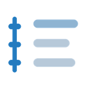

# 轮次索引靠左 · dsh-turn-rail-left

把 DeepSeek Harness 对话里那条**轮次导航轨道**（每轮一个刻度、悬停出预览、点击跳转）从右侧留白搬到**左侧留白**。

The DeepSeek Harness conversation shows a per-turn navigation rail — one tick per turn, hover preview, click to jump — in the right gutter. This plugin mirrors it into the left gutter.



## 它做什么

- 轨道框架整体移到左侧留白；刻度改为自外缘向左生长；键盘焦点环跟到外缘；悬停预览卡片改为朝正文展开；入场动画反向
- **刻度、当前轮高亮、运行中闪烁、悬停预览（问题一行 + 回复三行）、点击跳转、点击未加载轮次时先分页拉取历史再落到该轮**，全部仍是 DSH 内置实现，一行逻辑都没有重写
- 内置的两条显示规则原样保留：第二轮对话起才出现；正文可用宽度不超过 900px 时自动隐藏（按正文栏算，不按窗口算）
- 关闭插件即恢复右侧，不残留

## 装

在 DSH 里：

```bash
dsh plugin --profile desktop add github:liubaibuliuyan/dsh-turn-rail-left
```

或在 **插件 → 添加插件** 里填仓库地址 / 本地目录。装完刷新页面（`Ctrl+R`）让前端模块重新载入。

从插件市场安装时走同一条 Git 来源。

## 卸

```bash
dsh plugin --profile desktop remove @liubaibuliuyan/dsh-turn-rail-left
```

或在 **插件** 里关闭本 bundle：右侧轨道立刻回来。

## 间距

左侧默认 20px。右侧那 12px 之外还有滚动条，左侧没有滚动条，直接镜像成 12px 会看起来贴着侧边栏分隔线。想调就改 `client.js` 里的 `--turn-rail-left-inset`。

## 原理

一条样式表，挂在 `shell.overlay` 里渲染，不碰任何会话数据与工具。

轨道的类名是构建期生成的 CSS Module 哈希（`._6TmRoW_frame` 这种），没法直接选，所以按结构定位：**对话容器内、带无障碍名称、且每个刻度是一个 `data-index` 按钮的 `nav`**。所有规则共用这条选择链 —— DSH 一旦改动这段 DOM，整条轨道会一起退回右侧，而不是只偏移一半。

## 已知限制

- 在 DSH `0.2.2-rc.3`（Desktop 2.0.23-next）上编写与检查，`engines.dsh` 声明为 `>=0.2.2-rc.3`。升级 DSH 后如果轨道回到右侧，说明选择器需要按新结构复核
- 悬停预览沿用内置的 300px 宽、朝正文展开：在左侧它盖住的是**行首**而不是行尾，指针不动时卡片会留到下一次移动
- 只影响 Web / Desktop 界面

## English

Everything the built-in rail does is kept — one tick per turn, active highlight, running pulse, hover preview, click-to-jump, and paging history in for turns that are not loaded yet. Only the side changes: the rail sits in the left gutter, ticks grow from the outer edge, the preview opens towards the transcript, and the focus ring follows. The shipped display rules stay as they are: the rail appears from the second turn on and hides when the transcript column is at most 900px wide.

The plugin adds one stylesheet rendered into the `shell.overlay` slot. The rail is located structurally (the named `nav` inside the conversation whose marks are `data-index` buttons) because its class names are build-time CSS-module hashes; every rule shares that one selector chain, so a DSH DOM change drops the whole restyle and the rail falls back to the right instead of moving half-way.

Disable the bundle to get the original rail back. Written and checked against DSH `0.2.2-rc.3`.

## License

MIT
